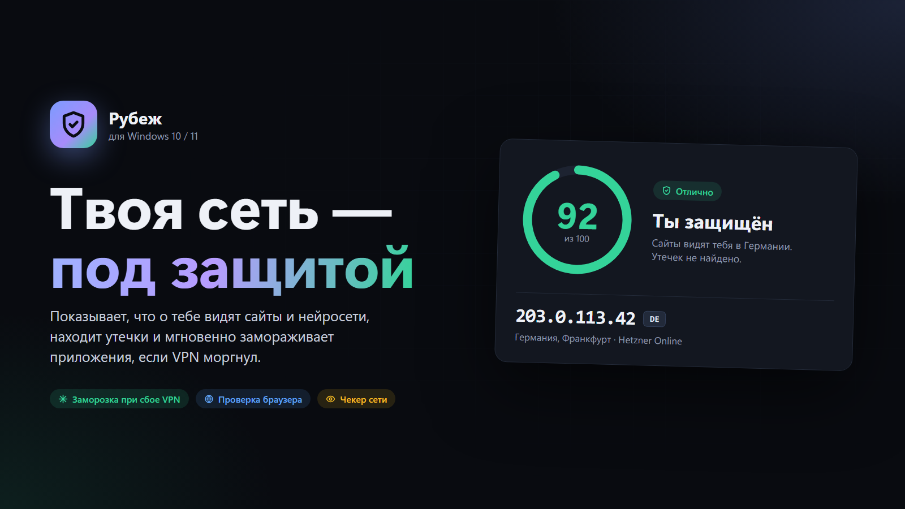
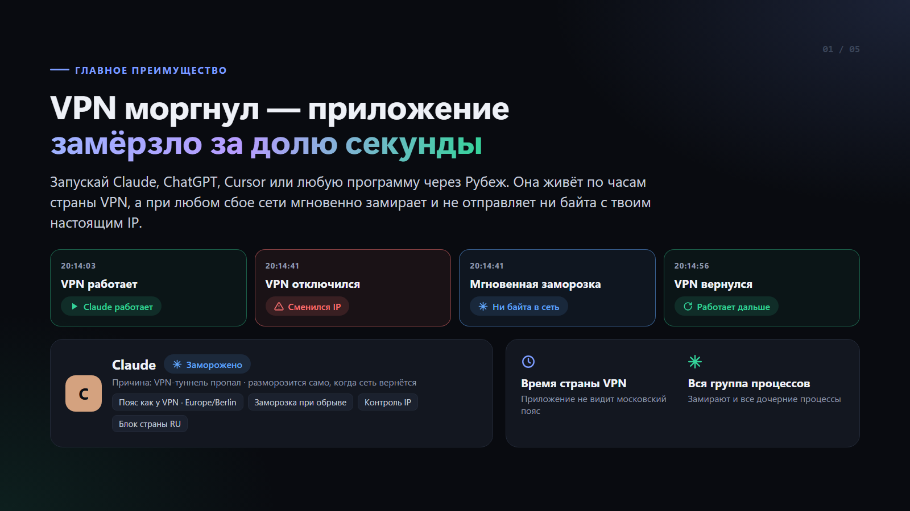
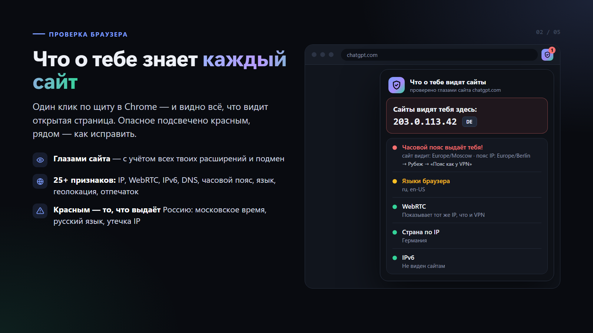
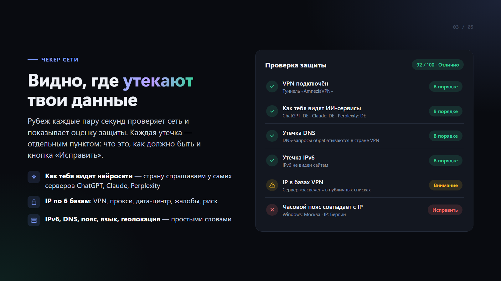
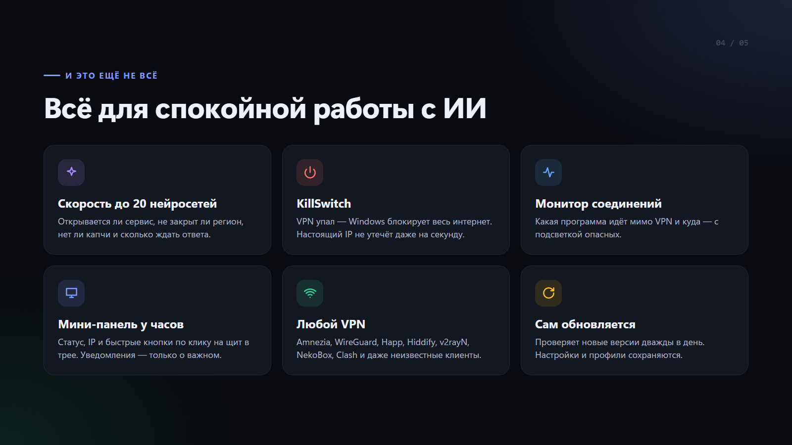
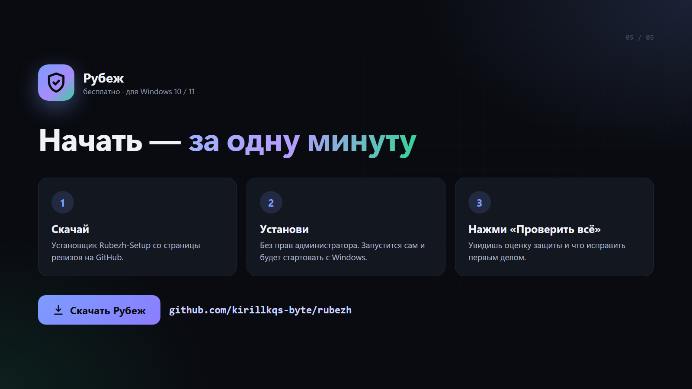

# Рубеж — защита сети и ИИ для Windows

Показывает, что о тебе видят сайты и нейросети, находит утечки и мгновенно замораживает приложения, если VPN моргнул.

## ⬇️ Скачать

**[Скачать последнюю версию](https://github.com/kirillkqs-byte/rubezh/releases/latest)** → в разделе *Assets* нажми `Rubezh-Setup-X.Y.Z.exe` и запусти.

- Права администратора не нужны, установка — меньше минуты.
- Нужна Windows 10/11 (компонент Microsoft Edge WebView2 уже есть в системе).
- Windows может показать «Windows защитила ваш компьютер» — программа новая и без цифровой подписи. Нажми «Подробнее» → «Выполнить в любом случае».

## ❄️ Главное: приложения под защитой

Запускай Claude, ChatGPT, Cursor или любую программу через Рубеж. Она живёт по часам страны VPN, а если VPN моргнёт или сменится IP — мгновенно замерзает вместе со всеми своими процессами и не отправляет ни байта с настоящим IP. Сеть вернулась — работает дальше с того же места.

## 🌐 Проверка браузера

Расширение для Chrome «Рубеж — что видят сайты»: один клик — и видно всё, что знает открытая страница. Проверка идёт глазами самого сайта, с учётом твоих расширений. Опасное — красным, рядом — как исправить.

## 🛡️ Чекер сети

Оценка защиты 0–100 и каждая возможная утечка отдельным пунктом: IP, IPv6, DNS, часовой пояс, язык, геолокация, базы VPN. Страну спрашиваем у самих серверов ChatGPT, Claude и Perplexity.

## ✨ И ещё

- **ИИ-сервисы** — доступность и скорость 20 нейросетей, блокировка региона, капча.
- **KillSwitch** — VPN упал — Windows блокирует весь интернет.
- **Монитор соединений** — какая программа идёт мимо VPN.
- **Мини-панель у часов** и уведомления Windows только о важном.
- **Любой VPN** — Amnezia, WireGuard, Happ, Hiddify, v2rayN, NekoBox, Clash и другие.
- **Сам обновляется** — проверяет новые версии дважды в день, настройки сохраняются.

